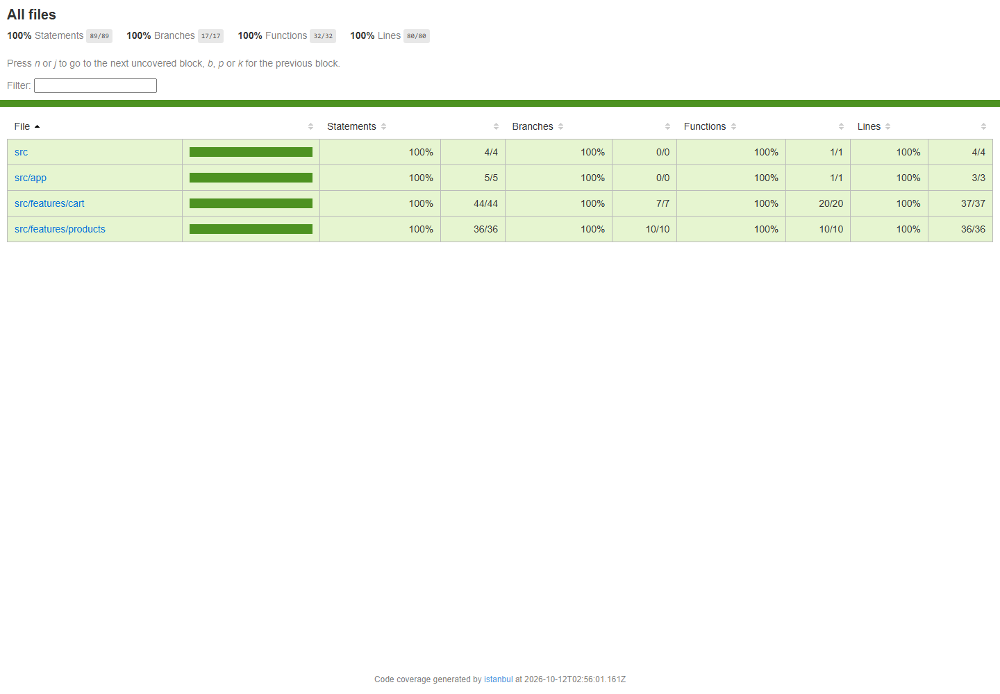

# Báo cáo kiểm thử: Sản phẩm – Giỏ hàng

## Công cụ và phạm vi

React + TypeScript + Redux Toolkit; Jest 29, ts-jest, jsdom, React Testing Library và user-event.
Không thay đổi logic ứng dụng. Integration test dùng Provider và Redux store thật, tạo store mới cho mỗi test. Mock `fetch` để không gọi mạng thật; khôi phục sau mỗi test.

Coverage bao gồm App.tsx, app/hooks.ts và toàn bộ mã production trong features/cart, features/products. Không tính test, fixture, setup, entry point main.tsx hay cấu hình store.ts. Jest kiểm tra ngưỡng tối thiểu 70% cho statements, branches, functions, lines ở nhóm features và phần còn lại của phạm vi.

## Chạy lại

Mở PowerShell:

```powershell
Set-Location 'C:\Users\DELL\Desktop\WEB NÂNG CAO\BUoi6\Bai3'
npm ci
npm run test:coverage
npm run build
```

`test:coverage` chạy `jest --coverage --runInBand`.

## Danh mục test (34 case, 5 suite)

| Suite | Số case | Nội dung |
| --- | ---: | --- |
| cartSlice.test.ts | 11 | Hàm action creator; state khởi tạo; thêm mới; tăng sản phẩm trùng và tính bất biến; xoá đúng ID; bỏ qua ID không tồn tại; cập nhật số lượng; số lượng 0/âm; xoá tất cả |
| productsSlice.test.ts | 8 | State khởi tạo; pending xoá lỗi cũ; API thành công và chuyển trạng thái; HTTP lỗi; lỗi mạng; rejection không phải Error; serialized error; lỗi dự phòng |
| hooks.test.tsx | 2 | useAppDispatch trả về dispatch thật và gửi action; useAppSelector phản ứng khi store thay đổi |
| Cart.test.tsx | 7 | Giỏ trống; render và tính tổng; tăng/giảm; nhập số lượng; giảm về 0; xoá một; xoá tất cả |
| ProductsList.test.tsx | 6 | Loading → thành công; HTTP lỗi; lỗi mạng; danh sách rỗng; không fetch lại; App thêm sản phẩm hai lần và cập nhật giỏ |

Các test API bất đồng bộ dùng `mockResolvedValue`/`mockRejectedValue`, `await store.dispatch(...)` hoặc `findByRole`/`findByText`. Không dùng timeout cố định. Unit test cho hàm là action creator `addToCart`; không tạo hàm production thừa chỉ để kiểm thử.

## Kết quả đã chạy

- 5/5 suite passed, 34/34 test passed.
- Statements: **100%**.
- Branches: **100%**.
- Functions: **100%**.
- Lines: **100%**.
- `npm run build`: thành công.

Ảnh báo cáo thật từ HTML do Jest/Istanbul sinh ra:



Ảnh nộp bài: `C:\Users\DELL\Desktop\WEB NÂNG CAO\BUoi6\Bai3\docs\coverage.png`.
Báo cáo tương tác sau khi chạy: `C:\Users\DELL\Desktop\WEB NÂNG CAO\BUoi6\Bai3\coverage\index.html`.
Dữ liệu tổng hợp: `C:\Users\DELL\Desktop\WEB NÂNG CAO\BUoi6\Bai3\coverage\coverage-summary.json`.

Thư mục coverage được bỏ qua trong Git vì có thể tái tạo; ảnh trong docs được giữ để nộp. Coverage 100% chỉ áp dụng cho phạm vi trên, không có nghĩa ứng dụng không còn lỗi.

## Lưu ý môi trường

Cấu hình ts-jest dùng CommonJS và ignoreDeprecations 6.0 để tương thích TypeScript 6 hiện được cài từ dependency `latest`. npm báo 36 lỗ hổng (5 moderate, 31 high) lúc cài dependency; chưa tự động sửa bằng `--force` vì có thể gây breaking changes. Node cũng có cảnh báo deprecated `punycode` từ dependency, không làm test thất bại.
